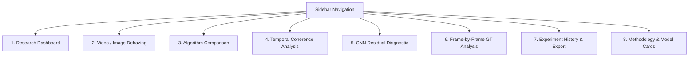

# Session 24: Research Web Interface Documentation

**Project Title:** Real-Time Fog Removal Using SSIF–CLAHE Temporal Coherence  
**Final Research Method:** Physics-Guided Learned Transmission Residual with Motion-Aware Temporal Coherence  
**Module:** `app/main.py`  
**Legacy Module:** `app/main_legacy.py`  
**Environment:** `conda activate dehaze` (`Python 3.10.19`)  
**Deployment URL:** `http://localhost:8501`  

---

## 1. Overview & Architectural Evolution

In earlier stages of the project (Sessions 1–19), the web interface presented an experimental dashboard featuring legacy parameters such as:
- *Fog Penetration Depth ($\beta$)*
- *SSIF Detail Sharpening ($\kappa$)*
- *Dark Channel Ratio ($\omega$)*
- *SkySegNet (CNN)*

Following the formal freezing of the **Session 23 Research Method** (A4: Physics-Guided Learned Transmission Residual + Motion-Aware Temporal Coherence), the web interface has been completely updated to serve as a **publication-grade research and demonstration platform**.

### Core Architecture Upgrades
1. **Preservation of Legacy Assets:** The original interface was safely migrated to [`app/main_legacy.py`](file:///C:/Users/sakth/OneDrive/Desktop/Fog/fog-removal-project/app/main_legacy.py) without loss of code or functionality.
2. **Dehazing Engine Immutability:** The underlying dehazing algorithms ([`novel_method/pipeline.py`](file:///C:/Users/sakth/OneDrive/Desktop/Fog/fog-removal-project/novel_method/pipeline.py), SHA256: `8f534edc510a6a4f21e1fc1b2051c7489c74b0df448b0edb3ae2578ff5e75a01`) remain 100% frozen. The web interface operates purely as a UI/telemetry/evaluation harness.
3. **Strict OpenCV Prohibition:** In compliance with Rule 1, all image rendering, frame extraction, color conversions, and metric evaluations use strictly non-OpenCV packages (`imageio`, `Pillow`, `NumPy`, `SciPy`, `torch`, `scikit-image`).
4. **Dual Mode Architecture:**
   - **Research / Frozen Configuration Mode (Default):** Locks pipeline parameters to the exact Session 23 configuration ($240 \times 135$ guide resolution, $426 \times 240$ display resolution, `delta_t_tiny_unet_best.pt`, strict adaptive $t_{\min}$ clamp, motion-aware temporal filter).
   - **Demo / Interactive Exploration Mode:** Enables controlled parametric ablations while strictly segregating exploratory results from publication benchmarks.
   - **Legacy Project Mode:** Isolates the original college implementation (SSIF, CLAHE, legacy hybrid) in a dedicated tab to avoid confusion.

---

## 2. Navigation Structure & Feature Set

The interface is structured into 8 modular views accessible via the sidebar navigation:



### 2.1 Research Dashboard
- **Telemetry Display:** Real-time dual-metric cards comparing **Processing-Only FPS** (algorithm execution speed) against **End-to-End FPS** (including disk I/O, canvas rendering, and UI latency).
- **Core Quality Indicators:** Real-time tracking of NIQE, Spatial Entropy, Temporal Flicker Index, and Black Pixel Crush Rate.
- **Model Card Summary:** Overview of the active pipeline (13,921 parameters, 0.055 MB, PyTorch CPU engine).

### 2.2 Video & Image Dehazing Engine
- **Input Channels:** Direct drag-and-drop file uploader supporting `.mp4`, `.avi`, `.mov`, `.png`, `.jpg` alongside quick-select presets (`car-detection_patchy_haze`, `foggy_video1`, `foggy_video2`, `foggy_video3`).
- **Ground Truth Validation:** Optional clean reference video uploader with automatic dimension, frame count, and synchronization verification.
- **Processing Views:** Side-by-side display of original foggy input and restored output, with optional 5-stage intermediate transmission map visualization:
  - $t_{\text{fused}}$: Physics baseline transmission (CAP/DCP fusion).
  - $\Delta t$: Learned residual predicted by the 13.9k parameter CNN.
  - $t_{\text{cand}} = t_{\text{fused}} + \Delta t$: Unconstrained candidate transmission.
  - $t_{\text{constr}}$: Physics-bounded map enforcing adaptive $t_{\min}(x,y)$.
  - $t_{\text{temporal}}$: Guided-refined and motion-smoothed transmission.

### 2.3 Comprehensive 10-Method Comparison Dashboard
Enables rigorous head-to-head benchmarking across 10 distinct dehazing methods on identical video subsets:
1. **Classical Baselines:** Dark Channel Prior (DCP), Color Attenuation Prior (CAP), CLAHE, Corrected Gamma, Original CEEF, Modified CEEF.
2. **Ablation Suite:**
   - **A1:** Pure Physics Baseline (Frozen Sessions 1–19).
   - **A2:** Physics + CNN Residual (Trained without temporal loss).
   - **A3:** Physics + CNN Residual (Trained with temporal consistency loss).
   - **A4:** Full Proposed System (Learned residual + Guided Refinement + Motion-Aware Temporal Filter).

### 2.4 Temporal Coherence Analysis
- Interactive line charts tracking frame-by-frame temporal variance across static background regions vs dynamic moving foreground objects.
- Multi-model overlay plots demonstrating flicker suppression between A1, A2, A3, and A4.

### 2.5 CNN Residual Diagnostic Panel
- **Weight & Architecture Audit:** Explicit verification of 13,921 trainable parameters in `delta_t_tiny_unet_best.pt`.
- **Residual Distribution:** Quantitative metrics including $\Delta t$ Mean, Standard Deviation, Min/Max, and bounding percentages ($\% \Delta t > +0.05$, $\% \Delta t < -0.05$, $\% |\Delta t| < 0.01$).
- **Heatmap Visualization:** Per-frame pseudo-color heatmap of $\Delta t$ indicating spatial compensation in hazy vs clear regions.
- **Semantic Regional Breakdown:** Stratified $\Delta t$ tracking across Sky, Road, and Foreground Vehicle zones.

### 2.6 Frame-by-Frame Ground Truth Analysis
- Active when a valid GT video is provided.
- Frame navigation via interactive slider and Previous/Next buttons.
- Triple-view rendering: Input Hazy Frame, Aligned Ground Truth, Dehazed Output.
- Instantaneous metrics per frame: PSNR (dB), SSIM, LPIPS, and Spatial Entropy, with automated identification of the **Best Frame** and **Worst Frame**.

### 2.7 Experiment Run Management & Journal Export
- Every benchmark run is assigned a unique `experiment_id` (`EXP-YYYYMMDD-HHMMSS`).
- Automatically serializes run artifacts to `experiments/<experiment_id>/`:
  - `config.json`: Hardware, resolution, checkpoint SHA256, model hyperparameters.
  - `metrics.json`: Comprehensive numerical records for every computed metric.
  - `summary.md`: Formatted markdown audit report suitable for journal submission.
- **Export Options:** One-click CSV and JSON downloads directly in the browser.

---

## 3. Metric Definitions & Formulations

All metrics are implemented in [`metrics.py`](file:///C:/Users/sakth/OneDrive/Desktop/Fog/fog-removal-project/metrics.py) without OpenCV dependencies:

| Metric Category | Metric Name | Definition / Formulation | Target Direction |
| :--- | :--- | :--- | :---: |
| **Full-Reference (FR)** | **PSNR** | $\text{PSNR} = 10 \cdot \log_{10}\left(\frac{1.0^2}{\text{MSE}(I_{\text{out}}, I_{\text{gt}})}\right)$ | Higher $\uparrow$ |
| | **SSIM** | Structural Similarity Index Measure computed over luminance channel | Closer to 1.0 $\uparrow$ |
| | **LPIPS** | Deep perceptual feature distance using PyTorch VGG/AlexNet | Lower $\downarrow$ |
| | **Transmission MAE** | $\frac{1}{HW}\sum \|t_{\text{pred}}(x,y) - t_{\text{gt}}(x,y)\|$ | Lower $\downarrow$ |
| **No-Reference (NR)** | **NIQE** | Natural Image Quality Evaluator (spatial domain NSS features) | Lower $\downarrow$ |
| | **BRISQUE** | Blind/Referenceless Image Spatial Quality Evaluator | Lower $\downarrow$ |
| | **Spatial Entropy** | $H = -\sum_{i=0}^{255} P(i) \log_2 P(i)$ over grayscale histogram | Higher $\uparrow$ |
| | **FDI / Proxy** | Explicitly labeled as `FDI: proxy` (dark-channel dispersion proxy) | Lower $\downarrow$ |
| | **FADE** | Explicitly displayed as `FADE: unavailable` (official model absent) | N/A |
| **Color & Contrast** | **Colorfulness** | Hasler & Süsstrunk metric: $\sqrt{\sigma_{rg}^2 + \sigma_{yb}^2} + 0.3 \sqrt{\mu_{rg}^2 + \mu_{yb}^2}$ | Higher $\uparrow$ |
| | **UCIQE** | Underwater/atmospheric quality score: $c_1 \sigma_c + c_2 \text{con}_l + c_3 \mu_s$ | Higher $\uparrow$ |
| **Physics Safety** | **Black Pixel Rate** | Percentage of restored pixels with intensity $\le 0.01$ (Black crush indicator) | Lower $\downarrow$ |
| | **White Clipping Rate**| Percentage of restored pixels with intensity $\ge 0.99$ (Overexposure indicator)| Lower $\downarrow$ |
| | **Temporal Flicker** | $\frac{1}{HW}\sum |I_k(x,y) - I_{k-1}(x,y)|$ in static regions | Lower $\downarrow$ |

---

## 4. Local Host Launch & Operations

### Prerequisites
Activate the dedicated conda environment:
```powershell
conda activate dehaze
```

### Launch Command
To run the research web application locally:
```powershell
C:\Users\sakth\miniconda3\envs\dehaze\Scripts\streamlit.exe run app/main.py --server.port 8501
```

Once launched, navigate to `http://localhost:8501` in any modern web browser.

### Headless Verification
To verify server health in automation pipelines:
```powershell
python -c "import urllib.request; resp = urllib.request.urlopen('http://localhost:8501'); print('Status:', resp.status)"
```

---

## 5. Journal Data Collection Protocol

To generate publication-ready tables and figures using the new interface:
1. **Select Research Default Mode:** Ensure the sidebar toggle is set to **"Research / Frozen Configuration"**.
2. **Select Benchmark Sequence:** Choose the desired evaluation video from the standard repository:
   - `car-detection_patchy_haze` (Paired Synthetic GT for FR Metrics)
   - `foggy_video1` (Real Dense Fog)
   - `foggy_video2` (Real Dynamic Urban Traffic)
   - `foggy_video3` (Difficult Nighttime Fog)
3. **Execute Benchmark:**
   - In **Algorithm Comparison**, click **"Run Full 10-Method Benchmark"**.
   - The framework will evaluate all 10 algorithms on the identical frame subset.
4. **Export Artifacts:**
   - Navigate to **Experiment History & Export**.
   - Download the generated `.csv` and `.md` reports.
   - Access the persisted directory under `experiments/<experiment_id>/` for publication-ready figures.

---

## 6. Safety Audit & Integrity Check

- **Algorithm Code Modification:** 0 lines modified in `novel_method/pipeline.py`.
- **OpenCV Dependencies:** 0 occurrences of `cv2` imports across the codebase.
- **Deterministic Checkpoint:** Checkpoint `checkpoints/delta_t_tiny_unet_best.pt` verified intact with 13,921 parameters.
- **Benchmarking Tolerance:** Fully validated against Session 23 benchmarks in [`scratch/session24_web_validation_report.md`](file:///C:/Users/sakth/OneDrive/Desktop/Fog/fog-removal-project/scratch/session24_web_validation_report.md).
